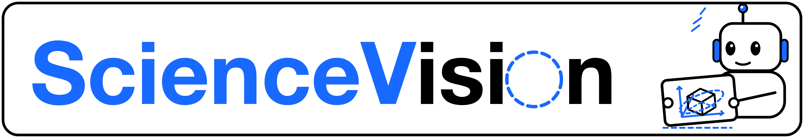
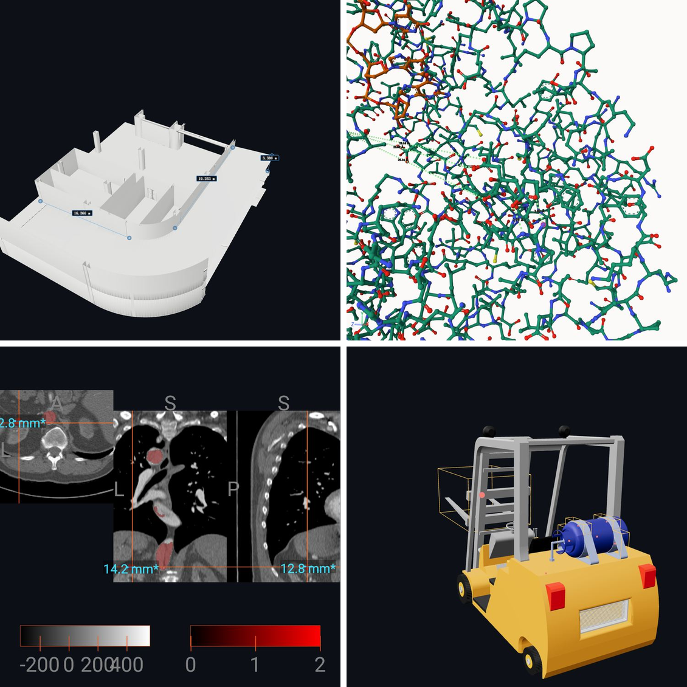
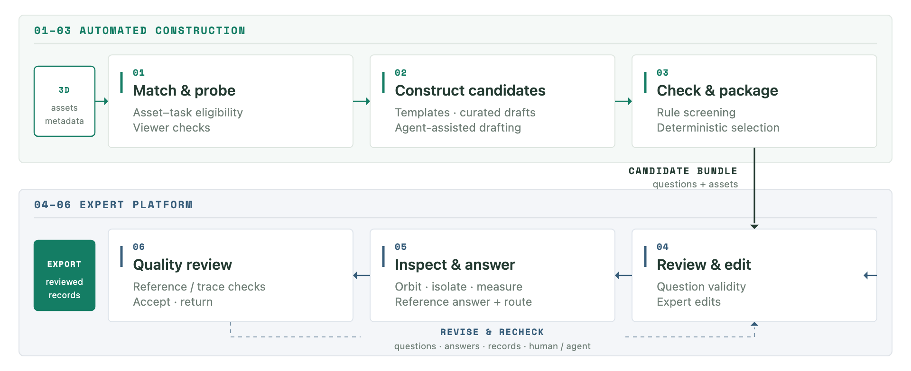

<div align="center">
  

  <h1>ScienceVision: Can AI Observe and Reason Like a Scientist?</h1>

  <p>
    <a href="https://unipat.ai/blog/ScienceVision"></a>
    <a href="https://unipat.ai/blog/ScienceVision#leaderboard"></a>
    <a href="https://huggingface.co/datasets/UnipatAI/ScienceVision"></a>
    <a href="https://github.com/UniPat-AI/ScienceVision"></a>
    
    <a href="paper/sciencevision.pdf"></a>
  </p>
</div>

> A benchmark for observing and reasoning over scientific 3D data.

**ScienceVision** asks whether a model can do what a scientist does with a 3D object: look at it,
change the view, isolate a structure, measure a distance, and answer. The release holds **250
expert-authored questions** — 50 each in architecture, biology, chemistry, mechanical CAD, and
medical imaging — over buildings, proteins, crystals, CAD assemblies, and CT volumes.

What the benchmark varies is **where the evidence comes from**: the source artifact and code
execution, an inspection tool that orbits, isolates, slices and measures, or a fixed set of
rendered views. Answers are graded **field by field by a deterministic scorer, not a judge
model**. A task with a missing or invalid scoring contract is reported as *blocked*, never as a
score of zero.

Read the [blog post](https://unipat.ai/blog/ScienceVision) for the motivation and the figures, or
take the [dataset](https://huggingface.co/datasets/UnipatAI/ScienceVision) directly.

## The 3D viewer and Vision MCP



*Recorded expert sessions, top left to bottom right: a building model with measured spans, a
protein contact check, a CT volume with tri-planar measurements, and a CAD assembly. Every frame
is the in-browser viewer that experts and agents operate.*

### 3D viewer

Every source asset opens in a browser viewer, without a build step or a plugin: **35 renderer
pages** covering meshes (Three.js), molecules (Mol*, reading mmCIF/PDB/SDF), volumes (NiiVue,
NIfTI/NRRD), CAD (OpenCascade, STEP/IGES), USD, point clouds, URDF and scenes. The viewer is not
a screenshot gallery: it reports camera state, measurements and selection state, which is what
lets an agent act on what it sees. The [blog](https://unipat.ai/blog/ScienceVision#inspect)
embeds five live samples you can orbit in place.

```bash
cd harness
python3 _dev_serve.py
# open http://127.0.0.1:8080/viewer/ and start at "Domain 3D Assets"
```

The checkout ships demo assets; the full corpus comes from the dataset package. Per-domain
manifests live in `harness/viewer/assets/`, and the page index in `harness/viewer/assets.index.json`.

### Vision MCP

The same scene is exposed to agents as an MCP server: **58 tools**, of which **19 `sv3d_*` tools**
act on the live 3D scene — open and close a scene, orbit, dolly, pan, set a view, render, slice,
clip, set a crosshair, segment, measure and annotate. Each task contract declares the subset an
agent may call, so the tool surface and the grading contract stay aligned.

```bash
pip install -e "harness[mcp]"
python -m sci3d_agent.mcp.server --surface   # tool catalog, counts and sha256
python -m sci3d_agent.mcp.server             # stdio server
```

The two MCP settings differ in what else the agent may see: **3D + Scaffold + Vision MCP** keeps
the source artifact and code execution, while **3D + Vision MCP** withholds the source and leaves
only the tools. A package name is a deployment layout, not an access setting; the
[container guide](docs/containers.md) keeps the two apart.

## Leaderboard

Twelve models over the same 250 questions under three access settings. Mean `answer_score` on
`[0, 1]`, ineligible trials counted zero; every setting averages three runs per question.


*`cc-3d` gives the agent the source artifact and code execution. `cc-mcp` adds the inspection
tools: change views, isolate structures, inspect slices, measure geometry.*

| # | Model | `cc-3d` | `cc-mcp` | `cc-2d-6` |
|--:|---|---:|---:|---:|
| 1 | GPT-6 Astra | 0.5291 | 0.5282 | 0.2498 |
| 2 | GPT-6.1 Sol | 0.4893 | 0.5110 | 0.2044 |
| 3 | Claude Fable 5.1 | 0.4619 | 0.4631 | 0.2965 |
| 4 | Claude Opus 5.5 | 0.4539 | 0.4343 | 0.2383 |
| 5 | Gemini 4 Argon | 0.4278 | 0.4321 | 0.1462 |
| 6 | Qwen3.8 Max 0902 | 0.3830 | 0.3736 | 0.2450 |
| 7 | Qwen3.8 Flash | 0.3616 | 0.3681 | 0.2468 |
| 8 | Kimi K3 | 0.3609 | 0.3369 | 0.2148 |
| 9 | GLM-5.3 Flash | 0.2846 | 0.2858 | 0.1521 |
| 10 | DeepSeek V4 Flash | 0.2652 | 0.2678 | 0.1661 |
| 11 | Doubao Seed Evolving | 0.2435 | 0.2527 | 0.1102 |
| 12 | Hunyuan-4 Preview | 0.1598 | 0.1738 | 0.0824 |

Under both 3D settings the five closed-source models place ahead of every open-source model. The
best overall mean is 0.53 and the highest single discipline cell is 0.65, so nothing is
saturated. The six-view setting orders differently: Claude Fable 5.1 leads it.


*Six rendered views, three runs. Evidence has to come from the supplied images.*


*Each column carries its own scale, whose maximum sits under the discipline name, so bar length
compares models within a discipline, not disciplines with each other.*

**Two things to know before quoting any of this.** The comparison is a *splice*: each model's row
joins a carried-over segment with a re-run segment, and six models take their re-run segment from
a separate evaluation service. Gemini 4 Argon's carried-over segment has two runs rather than
three, and three of Hunyuan-4's six-view questions have two. The
[comparison notes](docs/leaderboard.md) record the segment sources, the question-set provenance,
and the version drift in full, and state the resulting limit plainly: *equal coverage does not
establish a controlled comparison*.

## Dataset

**ScienceVision** holds 250 tasks, 50 per domain, with source assets, rendered views, expert
answers and the recorded expert sessions they were selected on. Tasks are grouped into 22
sub-domains and 30 direction labels; 143 ask for a single answer field and 107 for two or more.
The 250 questions were written and reviewed by 66 experts across the five disciplines, 482.98
recorded hours in all.

| Domain | Tasks | Sub-domains | `assets/` files |
|---|---:|---:|---:|
| Architecture | 50 | 4 | 57 |
| Biology | 50 | 5 | 50 |
| Chemistry | 50 | 5 | 50 |
| Mechanical CAD | 50 | 4 | 110 |
| Medical imaging | 50 | 4 | 58 |
| **Total** | **250** | **22** | **325** |

Every task is a self-contained directory: `question.md`, `answer.json`, `normalized.json`,
`task_and_trajectory.json`, its `assets/`, and the rendered `views/` and `views-aligned/`. Every
task also ships a reference solution under `oracles/<task_id>/solution/`, and 54 tasks declare a
task-specific rubric in `verifier/scoring/`.



*Construction is automated up to a candidate bundle (01–03); experts then review, inspect, answer
and certify (04–06). Every gold scores itself under its contract, every oracle reaches 1.0, and
2,405 of the 2,406 recorded expert steps carry their screenshot.*

The dataset repository is private. Download requires a Hugging Face account that has been granted
access.

```bash
hf auth login
hf download UnipatAI/ScienceVision \
  --type dataset \
  --revision <commit> \
  --local-dir data/sciencevision
```

Download a **fixed revision, not a branch**. `<commit>` and the inventory that goes with it are
recorded in [`resources/dataset.json`](resources/dataset.json); the numbers in this repository
are tied to that snapshot.

Read the question and answer from `<domain>/<task_id>/normalized.json`. It is the one record
every task has. `answer.json` carries the expert ground truth in the form the scorer reads. The
[dataset guide](docs/dataset.md) covers the layout, the records, and the declared limitations.
Read them before quoting a score: they change what a per-task comparison means.

## Evaluation

Seven access settings, of which the paper reports three:

| Setting | What the agent may use | Reported |
|---|---|---|
| **3D + Scaffold** | Source artifacts and code execution | Yes |
| **3D + Scaffold + Vision MCP** | The same, plus Vision MCP inspection and measurement tools | Yes |
| **3D + Vision MCP** | Vision MCP tools only; source artifacts withheld | No |
| **2D + Scaffold ×1 / ×3 / ×6 / ×12** | That many fixed rendered views; no source artifacts | ×6 only |

The entire evaluation harness is vendored under [`harness/`](harness/), a copy of the
`eval-baseline` branch of `UniPat-AI/BabyVision-v2`. It installs from that directory and needs
Python 3.12 or later and a Docker-capable host. The `harbor` extra pins Harbor `v0.20.0`.

```bash
cd harness
python3.12 -m venv .venv
. .venv/bin/activate
python -m pip install -e ".[harbor]"
python -m scripts.harbor.run_end2end --help
python -m scripts.harbor.qa_gen_to_tasks --help
```

A deterministic replay sandbox lives in [`sandbox/`](sandbox/README.md). It builds Harbor task
trees from a contract file and a dataset package, scores archived answers, and checks every gold
against its own contract — no model calls, no sampling noise.

### Scoring standard

Scoring is deterministic and **fail-closed**:

- A task must set `evaluation_eligible = true`. Otherwise the result is **blocked, not zero**.
  Blocked trials are reported separately and never mixed into a mean as a model failure.
- An answer is **one JSON object**, or one `SCI3D_FINAL_JSON:` terminal marker carrying it. Prose
  is not parsed. Types survive: `3` and `"3"` are different answers.
- Every field declares a comparator. Seventeen are defined, from `exact` and `integer_equal`
  through `abs_tolerance` and `vector_abs_tolerance` to `voxel_member_of_set`, where the mask
  itself is the tolerance region.
- `answer_score` is `1.0` only when **every field matched**. Reports use `mean@3` (per-task mean
  over three runs, then averaged over tasks) and `pass@3`.

The scorer image records a manifest whose self-hash the CLI checks before scoring, so a modified
scorer cannot report as the pinned one. [The full standard](docs/evaluation.md#scoring-standard)
lists every comparator, the three supported contracts, the task contract, and what a run receipt
must record.

## Repository layout

```text
ScienceVision/
├── harness/            vendored eval harness: Harbor routes, agents, MCP server, viewer, scorer
├── sandbox/            deterministic replay: contract export, tree build, gold self-test
├── paper/              the compiled paper PDF
├── resources/          pinned dataset, harness, paper, and image references
├── docs/               evaluation, dataset, leaderboard, containers, project notes
├── schemas/            JSON schemas for the release records
├── scripts/            repository validation and image verification
└── assets/             figures used by this page
```

Large data and evaluation histories are not duplicated in Git.

## Containers

Images live under **`ghcr.io/unipat-ai`**. Pick the runtime that matches the route you are
running; scoring always uses the scorer the task contract names.

| Route | Codex | Claude Code |
|---|---|---|
| Raw task files | `sciencevision-codex` | `sciencevision-claude-code` |
| Rendered views | `sciencevision-codex-2d` | `sciencevision-claude-code-2d` |
| Bundled MCP tools | `sciencevision-codex-mcp` | `sciencevision-claude-code-mcp` |
| Client for an external HTTP MCP worker | `sciencevision-codex-mcp-client` | `sciencevision-claude-code-mcp-client` |

The external HTTP route also needs `sciencevision-mcp-worker`. Pull by digest, because a tag can
be repointed.

```bash
docker login ghcr.io
docker pull ghcr.io/unipat-ai/sciencevision-codex-mcp@sha256:852f66cc924105c61e5efe6f85e0b5b389e01c416f7e6c8a09fbda0a225a1c98
docker pull ghcr.io/unipat-ai/sciencevision-scorer@sha256:b2d62b237db316b4e668b146c1195bf52d77c6fd4215b915672c73849d0fbeb3
```

The [container guide](docs/containers.md) has every version with its digest, the
bundled-versus-external distinction, and the scorer versions.

## Citation and license

The paper is readable as a [PDF](paper/sciencevision.pdf); that copy is a working build, and the
[paper directory](paper/README.md) records its status and how a new build replaces it. The arXiv
posting, citation, and BibTeX will be published here and on the
[project page](https://unipat.ai/blog/ScienceVision) once settled. Until then, please describe
results by the setting and scorer version you used rather than by a single headline number. The
[comparison notes](docs/leaderboard.md) explain why that matters here.

The dataset package declares **MIT** in its card, `MANIFEST.json`, and `LICENSE`; that
declaration does not grant rights to the third-party assets inside it. Documentation, schemas,
utility scripts, and the evaluation implementation in this repository are **MIT** as well
([LICENSE](LICENSE)). Container contents keep their own. See [NOTICE](NOTICE) and the
[dataset guide](docs/dataset.md#interpretation-and-data-terms).

Contributions are described in [CONTRIBUTING.md](CONTRIBUTING.md). The
[project overview](docs/project.md) records what is still required before this release can be
read outside the organisation.
