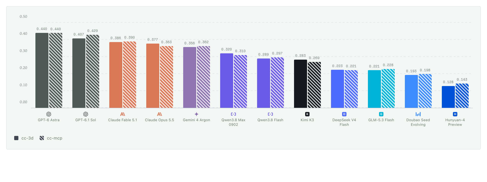
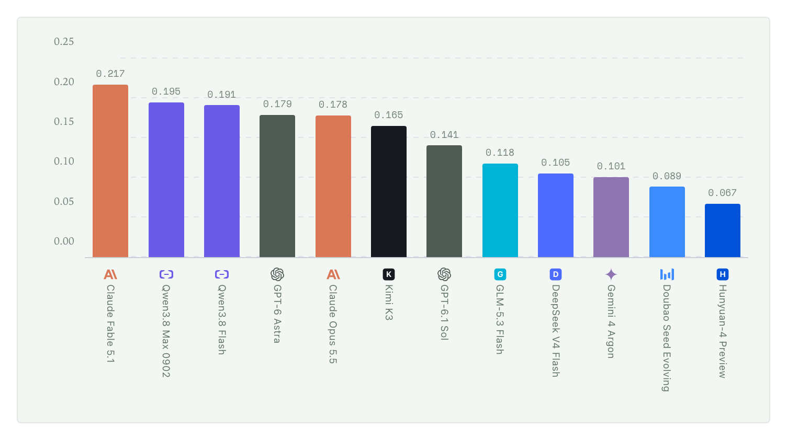
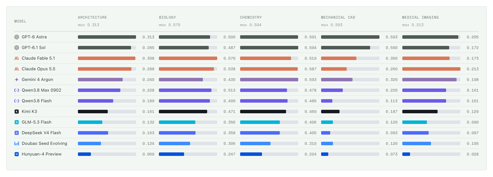

# Model comparison

Twelve models were run over the same **250 questions** under three access settings. This page
records what the numbers are, where each segment came from, and what the comparison does not
establish. Read it before quoting any figure.

## Metric

| Field | Value |
|---|---|
| Score | Mean `answer_score` on `[0, 1]` |
| Ineligible trials | Counted zero |
| Denominator | 50 tasks per domain, 250 overall |
| `cc-3d`, `cc-mcp` | `mean@3`: three runs per question, averaged per task, then over tasks |
| `cc-2d-6` | `mean@1`: a single run |

The two 3D settings share a metric and a scale, so they are charted together and answer whether
the inspection tools help. The six-view setting is scored differently and gets its own chart.

`answer_score` comes from the deterministic scorer described in
[evaluation.md](evaluation.md#scoring-standard). It is not a judge model's rating.

## The comparison

Under both 3D settings the five closed-source models place ahead of every open-source model.
No model reaches 0.60, and the best overall mean is 0.44, so the ceiling sits well out of reach
and nothing is saturated. Seven of the eleven adjacent pairs are cleanly ordered; four are not,
and one of those, Gemini 4 Argon against Claude Opus 5.5, has ranges that meet across a boundary
of 0.0002.

The six-view setting orders differently: Claude Fable 5.1 leads it, ahead of two open-source
models and every model that leads under 3D access.

**Read the position and the order, not the bar length.** This column is not adjusted for the
latest task replacements, because both batches ran the two 3D settings only, and its axis is a
different metric over half the range.

Each column carries its own scale, whose maximum sits under the discipline name, so bar length
compares models within a discipline and not disciplines with each other. Mechanical CAD,
medical imaging and architecture use most of their own range, 0.88, 0.87 and 0.78 of each
column's maximum, and their weakest models fall to 0.07, 0.03 and 0.07. Chemistry and biology
are flatter, spanning 0.62 and 0.57 of the column maximum with no model below 0.22.

## Where the numbers come from

The comparison is a **splice**. Every model's row joins a carried-over segment with a re-run
segment, and the segments were not produced by one harness:

| Segment | Source |
|---|---|
| Carried-over, both OpenAI rows | One Codex harness |
| Carried-over, six further models | A separate evaluation service |
| Carried-over, four models | The same harness family as their re-run |
| Re-run | The task replacements measured for this set |

Gemini 4 Argon covers **two runs rather than three** in both 3D settings; every other model
covers three.

The replacement batches measured the two 3D settings only, and the medical replacements are a
**single-rep pilot** whose three-rep run had not completed when this comparison was assembled.
Per-task comparisons hold within a batch, not across batches.

## Question set

This comparison uses the 250-question set. 202 questions carry over from an earlier evaluation,
32 were replaced in the previous round, and 13 more were replaced in this one. The 13 replacement
questions were measured on all twelve models; the other 237 rows are inherited.

## Version drift

The replacement questions and the inherited segments were measured on different days, and model
aliases carry no version. A difference between two rows therefore combines a replacement effect
and a possible version difference.

**Equal coverage does not establish a controlled comparison.**

## Reproducing a row

The collector writes per-task records and a leaderboard; the aggregator supports `flat`,
`domain_equal`, and explicit `weighted` modes. The official path requires positive process-gate
and runtime-attestation evidence, and diagnostic aggregation must be labelled as such. See
[performance.md](performance.md) for the native fields and the coverage rules, and
[evaluation.md](evaluation.md) for the run interfaces.
