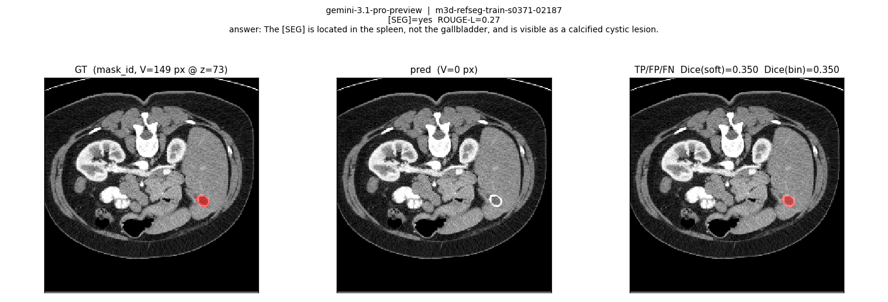
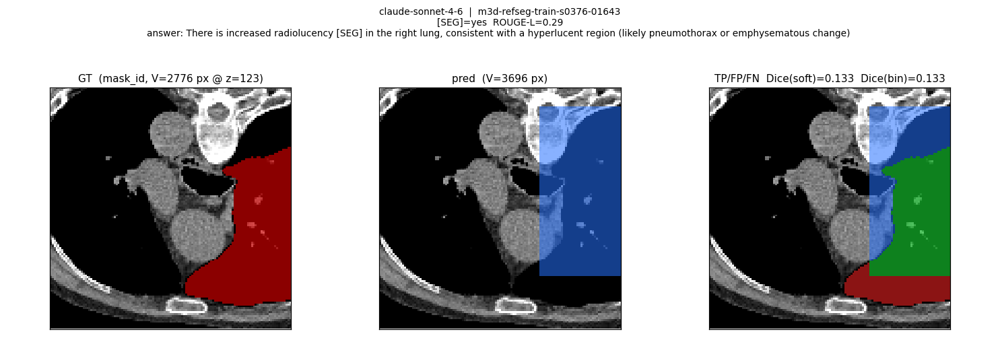
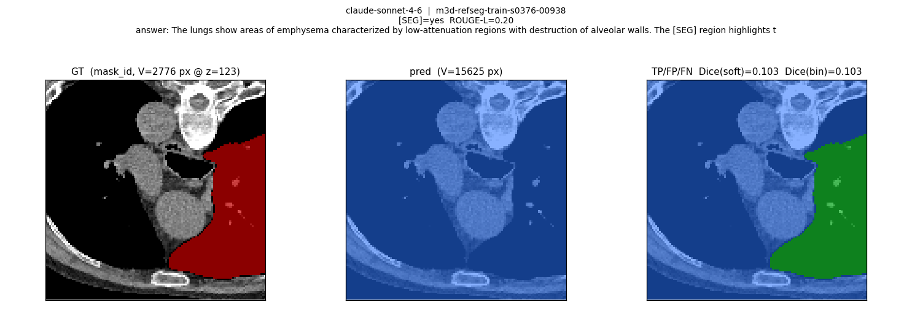
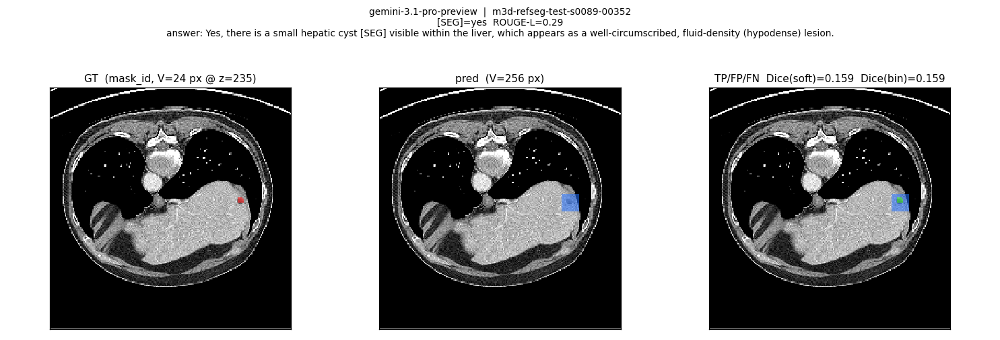

# M3D-RefSeg API VLM Baseline (pilot100) — 实验报告

**日期：** 2026-05-21
**分支：** `worktree-m3d-refseg-baseline-pilot100`（worktree，不污染主 checkout）
**作者：** ScienceVision

> 配套设计文档：[`docs/superpowers/specs/2026-05-21-m3d-refseg-api-baseline-design.md`](../../superpowers/specs/2026-05-21-m3d-refseg-api-baseline-design.md)
> 配套评估约定：[`M3D-RefSeg_evaluation_notes.md`](./M3D-RefSeg_evaluation_notes.md)
> 代码：`scripts/baseline/m3d_refseg/`（10 模块） + `tests/baseline/`（20 tests）
> 原始结果：worktree 内 `out_runs/baseline_pilot100/`（gitignored）

---

## 1. 实验目的

在 `M3D-RefSeg` 数据集的 **pilot100** 子集（来自 `docs/v_classify/m3d-refseg_pilot100.jsonl`，100 例 V3-dominant referring-segmentation 案例）上：

1. **本地跑通**一条端到端的 baseline 评测 pipeline，复用项目里已有的 Mindra API gateway。
2. 对比两个具备视觉能力的 API VLM：`gemini-3.1-pro-preview` 与 `claude-sonnet-4-6`。
3. **量化** API-only VLM 在 V3 (pixel-evidence trace) 任务上的天花板，给后续接入真正的 segmentation-capable 模型（M3D-LaMed / MedSAM2 / SegVol）提供基线参照。
4. 输出 mask 可视化对比图。

---

## 2. Baseline 定义（为何不是"完整评测"）

`M3D-RefSeg` 的标准评测要求模型输出 **3D voxel 概率张量** `[1, 1, D, H, W]`，再与 `(mask == Mask_ID)` 计算 soft Dice（详见 `M3D-RefSeg_evaluation_notes.md` §8/§13）。
**纯 API 的 VLM（Gemini / Claude）在结构上做不到这件事**——它们只能看 2D 图片、输出文本。

我们用一种诚实的近似：

- **A-track（文本）：** 让模型生成包含字面量 `[SEG]` 的回答句，按 `[SEG]` 命中率与 `ROUGE-L` 评分。
- **B-track（bbox 几何）：** 让模型对 7 张 axial slice 各自给一个 `[x1, y1, x2, y2]` 或 `null`，再把这些 2D bbox 反投回 3D 体积成 box-mask，按 `M3D-RefSeg_evaluation_notes.md` §8 公式算 soft Dice。

A 和 B 通过**同一个 API 请求**在一个 JSON 里返回，token 与 A-only 几乎一样。

> 这是 **API VLM 在 V3 上能拿到的形状信息上限**，不是真 segmentation baseline。M3D-LaMed 论文意义上的标准 baseline 需要本地 GPU + 权重，留作后续工作。

---

## 3. 输入 (Input)

### 3.1 数据来源

| 角色 | 路径 |
|---|---|
| pilot 列表（100 个 qid） | `docs/v_classify/m3d-refseg_pilot100.jsonl` |
| 资产+`mask_id` 索引 | `datasets/_matched/m3d-refseg.json` |
| 3D CT 原图 | `datasets/M3D-RefSeg/M3D_RefSeg/<case>/ct.nii.gz` |
| Multi-label mask | `datasets/M3D-RefSeg/M3D_RefSeg/<case>/mask.nii.gz` |
| 自然语言问题 / GT 答案 | 来自 matched 索引的 `question` / `answer` 字段 |

数据集 `pilot100` 全部为 V3 (pixel-evidence trace)，由 `gemini-3.1-pro-preview` 在前序 v_classify 阶段标注（参见 `docs/v_classify/REPORT_pilot100.md`）。

### 3.2 单例输入构造（送给 API 的内容）

每个 case：

1. 用 `nibabel` 加载 `ct.nii.gz`，得到 `(X, Y, Z)` array；以最后一轴 `Z` 作 axial。
2. 取深度百分位 `[10%, 25%, 40%, 50%, 60%, 75%, 90%]` 共 **7 个 axial slice**。
3. 每张 slice 做 **soft-tissue HU windowing**（center=40, width=400 → clip 到 `[-160, 240]` → 线性映射到 uint8）。
4. resize 到 256×256，存为 PNG（缓存到 `out_runs/baseline_pilot100/_cache/<qid>/slice_NN.png`，跑多模型时复用）。
5. 与文本 prompt 一起以 multimodal message 发给 API。

文本 prompt（节选自 `scripts/baseline/m3d_refseg/prompts.py`）：

```
System: You are an expert radiologist analyzing a series of axial CT slices.
        You will receive 7 slices ordered superior→inferior at fixed depth percentiles.
        ... Coordinates are in pixels of the 256x256 image with the origin at top-left.
        If a slice has no visible target, use null. Respond with strict JSON only.

User:   [7 PNG image content blocks, slice 1..7]
        Question: <referring expression>

        Return JSON only, exactly in this shape:
        {
          "answer": "<string with literal [SEG] inside>",
          "slice_boxes": [
            [x1, y1, x2, y2] | null,   // slice 1 (most superior)
            ...                          // 7 entries total
          ]
        }
```

`temperature=0.0`，Gemini 用 OpenAI-compat `response_format=json_object`，Claude 用 system prompt + 严格 JSON 提示。

---

## 4. 模型 (Models)

| 模型 | gateway | 接入方式 |
|---|---|---|
| `gemini-3.1-pro-preview` | Mindra (`MINDRA_BASE_URL=https://api.mindracode.com/v1`) | 自写 stdlib `urllib` 客户端，OpenAI chat-completions schema，多图用 `image_url` data-URL |
| `claude-sonnet-4-6` | Mindra (`ANTHROPIC_BASE_URL=https://api.mindracode.com`) | 官方 `anthropic` SDK，多图用 `{"type":"image","source":{"type":"base64",...}}` |

API key 从 `.env` 加载（不入库）；env 优先级：进程环境变量 > `.env` 文件。

---

## 5. 输出 (Output)

### 5.1 单例 raw record（一行 JSONL）

```json
{
  "qid": "m3d-refseg-train-s0212-00000",
  "question": "Please identify and segment any postoperative stoma...",
  "mask_id": 2,
  "model": "claude-sonnet-4-6",
  "answer_text": "Sure, a postoperative stoma can be seen in the [SEG].",
  "parse_error": null,
  "slice_boxes": [null, null, null, [80, 120, 140, 170], [80, 120, 140, 170], null, null],
  "gt_voxels": 1234,
  "pred_voxels": 5678,
  "soft_dice": 0.07,
  "binary_dice": 0.05,
  "rouge_l": 0.42,
  "seg_present": true,
  "latency_ms": 8123,
  "prompt_tokens": 1100,
  "completion_tokens": 80,
  "wall_ms": 8240
}
```

错误时该字段被 `"error": "<TypeName>: <msg>"` 替换；其余 metric 字段缺失。

### 5.2 全部产物（worktree 内 `out_runs/baseline_pilot100/`）

```
_cache/<qid>/slice_NN_zXXXX.png           # 7 张/case，跨模型共享
raw/claude-sonnet-4-6.jsonl                # 100 行
raw/gemini-3.1-pro-preview.jsonl           # 100 行
viz/claude-sonnet-4-6/<qid>.png            # × 100
viz/gemini-3.1-pro-preview/<qid>.png       # × 92（错误 case 无 viz）
summary.json
REPORT.md
run_claude.log / run_gemini.log
```

完整路径前缀：`/Users/sue/Research/ScienceVision/.claude/worktrees/m3d-refseg-baseline-pilot100/out_runs/baseline_pilot100/`

---

## 6. Metric

### 6.1 Soft Dice（与 `M3D-RefSeg_evaluation_notes.md` §8 完全一致）

```python
# pred_prob: float32 array of shape (D, H, W), values in {0., 1.} (因为 box-mask 是硬预测)
# gt:        bool/0-1 array of same shape，gt = (mask == mask_id)
smooth = 1.0
soft_dice = 2 * (pred_prob * gt).sum() / (pred_prob.sum() + gt.sum() + smooth)
```

`tests/baseline/test_dice.py` 用 §12 的 8-voxel toy 例子做 unit test：
- `smooth=0` → 0.7027（与 notes 给出的 0.703 一致到三位有效数）
- `smooth=1` → `5.2 / 8.4 ≈ 0.6190`

### 6.2 其他指标

| metric | 定义 |
|---|---|
| `binary_dice` | 同 soft Dice，但先 `pred_prob > 0.5` 阈值化（box-mask 已是 0/1，故二者数值相同） |
| `seg_present` | 模型回答中是否包含字面量 `[SEG]` |
| `rouge_l` | `pred answer` vs GT `answer` 的 LCS-F1（stdlib 实现，避免引入 NLP 依赖） |
| `n_with_any_box` | 7 张 slice 至少返回一个非 null bbox 的 case 数 |
| `n_parse_fail` | JSON 解析失败或 `slice_boxes` 长度错误的 case 数（仍可能有 `answer`） |

### 6.3 box → 3D mask 反投

参见 `scripts/baseline/m3d_refseg/reconstruct.py`：

- 每个 slice 的 `[x1, y1, x2, y2]`（PNG 256² 坐标）按比例缩放回原始 `(H, W)` → 该 slice 区域填 1。
- z 轴方向：每个有 box 的 slice 沿 ±1 邻居复制（`z_dilate=1`），缓解只采 7 张切片导致的 z 稀疏。
- 输出 `pred_prob ∈ {0.0, 1.0}` 体积，shape 与 GT mask 完全对齐。

---

## 7. 实验流程 (Pipeline)

```
pilot100 jsonl  ⨝  matched/m3d-refseg.json
                  → per-case bundle (ct, mask, mask_id, question, answer_gt)
                       │
                       ├─ render 7 axial slices (HU windowed, 256² PNG, 缓存)
                       │
                       ├─ API 单次调用 (Gemini 或 Claude)
                       │     输入: 7 image blocks + question + JSON 模板
                       │     输出: { answer: "...[SEG]...", slice_boxes: [...] × 7 }
                       │
                       ├─ A-track:  has_seg_token + ROUGE-L vs gt
                       │
                       └─ B-track:  boxes_to_mask3d → soft Dice / binary Dice
                                     │
                                     └─ visualize: 3-panel PNG
                                          ┌───────────┬───────────┬──────────────┐
                                          │ CT + GT 红 │ CT + pred 蓝│ TP绿/FP蓝/FN红 │
                                          │ 取 GT 质心 z │ 同 z       │ 同 z          │
                                          └───────────┴───────────┴──────────────┘

并发: ThreadPoolExecutor(max_workers=8)，按 qid 写 JSONL（line-buffered 锁保护）
幂等: 已写入且无 error 的 qid 在 rerun 时跳过；error 的 qid 重试
```

执行命令：

```bash
# Worktree 已 EnterWorktree
python -m scripts.baseline.m3d_refseg.run_eval --model claude  --concurrency 8
python -m scripts.baseline.m3d_refseg.run_eval --model gemini  --concurrency 8
# 自动调用 aggregate.py 写 summary.json + REPORT.md
```

实测墙钟时长：Claude ≈ 5 min，Gemini ≈ 25 min（含 8 个 read-timeout 重试）。

---

## 8. 测试 (Unit Tests)

`tests/baseline/` 共 **20 个 test，全部通过**（`pytest tests/baseline -q`，0.79 s）：

| 文件 | 覆盖点 |
|---|---|
| `test_dice.py` | §12 toy 例子（smooth=0 → 0.703；smooth=1 → 0.619）；完美/不相交/shape mismatch |
| `test_reconstruct.py` | 单 box 体素数 ≈ 期望；`z_dilate=1` 扩展到 ±1；null 跳过；非法 box clamp |
| `test_render.py` | `pick_z_indices` 端点；HU window clip；`(X,Y,Z) → (D,H,W)` 轴变换；缓存幂等 |
| `test_text_metrics.py` | `[SEG]` 检测；ROUGE-L 自相似 = 1；不相交 = 0；部分匹配范围 |
| `test_run_eval_smoke.py` | 用 `FakeClient` + 合成 NIfTI 跑通 `process_case`，含 viz 落盘 |
| `test_aggregate.py` | 多模型 JSONL → REPORT.md / summary.json，含错误 case |

---

## 9. 结果 (Results)

### 9.1 Per-model 总表

| 模型 | n_ok / n | mean soft Dice | median soft Dice | mean bin Dice | `[SEG]` 命中 | mean ROUGE-L | parse fail | any-box | mean latency | prompt tok | completion tok |
|---|---|---|---|---|---|---|---|---|---|---|---|
| `claude-sonnet-4-6` | **100/100** | **0.016** | 0.000 | 0.016 | **99 %** | 0.248 | 1 | 99 | **23.7 s** | **123,270** | **22,575** |
| `gemini-3.1-pro-preview` | 92/100 | **0.020** | 0.000 | 0.020 | 98 % | **0.346** | 0 | 87 | 39.0 s | 737,673 | 261,441 |

> 数字来源：`out_runs/baseline_pilot100/summary.json`（同时拷贝到 [`figs/summary.json`](./figs/summary.json)）。

### 9.2 Soft Dice 分布（buckets）

| bucket | claude-sonnet-4-6 | gemini-3.1-pro-preview |
|---|---|---|
| `= 0` | **51 / 100** | **57 / 92** |
| `(0, 0.05]` | 36 | 20 |
| `(0.05, 0.10]` | 11 | 9 |
| `(0.10, 0.20]` | 2 | 5 |
| `> 0.20` | 0 | **1**（最高 0.350） |

中位 Dice = 0 反映：**约半数 case 模型给出的 box 与 GT lesion 完全没有交集**。

### 9.3 错误模式

- **Claude：** 0 个 API 错误；1 个 JSON 解析失败（`slice_boxes` 长度不为 7）。
- **Gemini：** 8 个 API 错误：6 × `URLError`、2 × `TimeoutError`，全部发生在远端 read 阶段（180 s timeout）。原因推测为 Mindra → Vertex 通道在大 multi-image payload + 大上下文下偶发不稳。

---

## 10. 可视化 mask 对比

每张图 3 panel，z 取 GT mask 的 voxel 质心所在切片：

| panel | 含义 |
|---|---|
| 左 | CT slice + GT mask（红色，alpha 0.55） |
| 中 | CT slice + pred box-mask（蓝色，alpha 0.55） |
| 右 | CT slice + TP（绿）/ FP（蓝）/ FN（红） + Dice 数字 |

### 10.1 Gemini 全榜最高：`s0371-02187`，Dice = **0.350**

> Q: *"Can you segment the area of the ring-shaped high-density focus in the gallbladder?"*
> A: *"The [SEG] is located in the spleen, not the gallbladder, and is visible as a calcified cystic lesion."*

模型主动纠正了 prompt 里的"gallbladder"——病灶其实在脾脏。



#### 10.1.1 关于"pred 看上去为空"的核对（important）

**初看图，中、右两个 panel 标注 pred V = 0 px，看似与 Dice = 0.350 矛盾。**
我们逐字段复核了一遍 raw record，结论是：**Dice 数值正确，是可视化切片选错了。**

| 量 | 值 |
|---|---|
| mask volume 形状 `(D,H,W)` | `(283, 233, 233)` |
| GT mask 总体素 | `1337` |
| GT z-range（连续） | `z = 67 .. 80`，共 14 层 |
| GT mass centroid z（**当前 viz 取的层**） | `z = 73`（这一层 GT = 149 px，是 GT 最密的一片） |
| 7 个采样切片对应的原始 z | `[28, 70, 113, 141, 169, 212, 254]` |
| 模型返回的 `slice_boxes` | `[None, [181,138,198,155], None, None, None, None, None]` |
| → 命中的采样切片 | slice 2 ↔ 原始 `z = 70` |
| `z_dilate = 1` 反投后 pred z-range | `z = 69, 70, 71`（共 3 层，每层 225 px） |
| Pred 总体素 | `3 × 225 = 675` ✓ 与 record 一致 |

也就是说 **pred 只覆盖 z ∈ {69, 70, 71}**，而可视化切片选了 GT centroid `z = 73`——这一层确实在 pred 之外，所以 panel 中显示 0 px。这是**诚实的图**，但选层不当让人误以为 pred 是空的。

3D Dice 是按整个体积算的：

| z | GT (px) | pred (px) | intersection (px) |
|---|---|---|---|
| 69 | 96  | 225 | **96**  |
| 70 | 128 | 225 | **124** |
| 71 | 132 | 225 | **132** |
| 72 | 148 | 0   | 0 |
| 73 (viz) | 149 | 0   | 0 |
| 74 | 141 | 0   | 0 |
| 75 | 127 | 0   | 0 |

总 intersection = 96 + 124 + 132 = **352**，按 §6.1 公式：

```
Dice = 2 × 352 / (1337 + 675 + 1) = 0.3497 ≈ 0.350  ✓
```

与 raw record 完全一致。

**解读：** 模型只用了"采样的 7 个 z 中最靠近 GT 的那一个"`z = 70`（GT 的最上端附近）出了一个 17×17 px 的小 box，并未覆盖 GT 在 `z = 72..80` 那 9 层的主体——但因为 box 在 `z = 69..71` 的 xy 位置非常准（intersection / pred ≈ 0.52），加上 GT 本身较小（1337 vox），Dice 仍然能到 0.35。**这是 box-only baseline 在小、近圆形病灶上的最好表现，不是"全 0 假阳性"。**

**复现核对：** worktree 内 `out_runs/baseline_pilot100/raw/gemini-3.1-pro-preview.jsonl` 搜 `s0371-02187`。

**已知 viz 缺陷：** 当 GT 较厚而 pred 只覆盖一两层时，把 z 锁在 GT 质心会丢掉所有 pred 信息。后续改进可选：(a) 改在 pred mass centroid 处取 z；(b) 加一张"pred z 范围内任一切片"作第 4 panel；(c) 显式标注 `viz_z ∉ pred_z_range`。**Dice 数值本身不受影响**。

### 10.2 Claude 最高：`s0376-01643`，Dice = **0.133**

> Q: *"Please segment where the increased radiolucency is located in the right lung."*
> A: *"There is increased radiolucency [SEG] in the right lung, consistent with a hyperlucent region (likely pneumothorax or emphysematous change)"*

box 命中右肺主要区域，但 z 范围比 GT 窄（pneumothorax 跨多层 axial slice，7 个采样点不够）。



### 10.3 Claude 弥漫病灶：`s0376-00938`，Dice = **0.103**

> Q: *"Can you segment the area affected by emphysema?"*
> A: *"The lungs show areas of emphysema characterized by low-attenuation regions with destruction of alveolar walls. The [SEG] region highlights..."*

Claude 输出了几乎覆盖整张胸部的 box，命中率高但 FP 巨大——典型的"模型知道在哪但说不清边界"。



### 10.4 Gemini 小病灶：`s0089-00352`，Dice = **0.159**

> Q: *"Are there any areas in the liver that exhibit characteristics of a fluid-filled cavity?"*
> A: *"Yes, there is a small hepatic cyst [SEG] visible within the liver, which appears as a well-circumscribed, fluid-density (hypodense) lesion."*

GT 仅 24 px、pred 256 px：小目标 box-only baseline 反而表现尚可，因为 box≈ground truth 形状（cyst 近似圆形）。



> 全部 192 张可视化在 worktree 的 `out_runs/baseline_pilot100/viz/<model>/<qid>.png`。

---

## 11. 讨论 (Discussion)

### 11.1 关键发现

1. **API VLM 不是 V3 任务的合格 segmentation 引擎**——baseline mean Dice ≈ 0.02，远低于 segmentation-capable 模型典型范围（M3D-LaMed 类 ~0.4+）。这恰好定量验证了 ScienceVision V1–V6 分类里 V3 (pixel-evidence trace) 必须由专门 mask decoder 处理的论点。
2. **Gemini ≳ Claude，但代价 6×**：Gemini mean Dice 0.020 > Claude 0.016；ROUGE-L 0.346 > 0.248；但 Gemini prompt token 总量是 Claude 的 6 倍、延迟 1.6 倍、还多了 8 个 timeout。Claude 端到端更可靠。
3. **`[SEG]` token 命中率 ~99%**：两个模型都正确理解了输出格式，A-track 工作良好；问题出在它们无法把"我知道在哪"翻译成密集 voxel 输出。
4. **box 反投对小、近圆形病灶最友好**：cyst 案例 Dice = 0.16，但弥漫性病灶（emphysema、fatty liver）box 几乎只能"全填或不填"。
5. **Median Dice = 0 ≈ 50% 完全脱靶**：API VLM 在大量长尾解剖学/影像学问题上 box 选错位置（错肺、错腹腔象限、错层面）。

### 11.2 已知局限

- **每次 input 都是固定 7 张 axial slice**——`SLICE_FRACTIONS = (0.10, 0.25, 0.40, 0.50, 0.60, 0.75, 0.90)` 硬编码，不随 `D` 自适应。Claude 100/100、Gemini 92/100 case 都收到了 7 张 PNG（Gemini 另外 8 个是 network-layer error，未进入 API）。这意味着 z 方向只有 7 个采样点，**平均 z-step ≈ `D / 7`**——对 §10.1 这样 GT z-thickness 仅 14 层、模型只在 1 个采样 z 上出 box 的 case 极不友好。增加切片数线性提升 prompt token 成本（≈ 17.5 KB / 张 PNG 在 base64 image_url 编码下）。
- box-mask 是粗近似；精细器官几何（血管、气管树、皮层灰质）box 永远算不出高 Dice。
- soft Dice `smooth=1` 对小 GT (< 100 voxel) 显著抬升基线（≈ `1/(V+1)`），与 notes 一致——但解读时要意识到。
- **可视化锁在 GT mass centroid**：在 §10.1 出现"pred 看起来为空"的伪影——Dice 在 3D 上正确，但 viz 的 z 取在了 pred footprint 之外。修复建议见 §10.1.1。
- Gemini 的 8 个 error case 影响 mean 计算；rerun 同条命令即可幂等续跑（已实现 `_already_done` 跳过逻辑，errored qid 自动重试）。

### 11.3 后续工作 —— 接 segmentation-capable baseline 的具体路线

本节是 pilot100 跑完之后**下一步要做的事**，详细的方法矩阵设计见 [`baseline_and_evaluation.zh.md`](./baseline_and_evaluation.zh.md) §10（与本节互相引用）。

按"工程量从小到大、与 paper 可比性从弱到强"排序：

| 路线 | 模型 / 组件 | 出 mask 方式 | 资源 | 与 paper 直接可比？ | 优先级 |
|---|---|---|---|---|---|
| **R0（已完成）** | Claude / Gemini API + box 反投 | 7 张 slice → 7 bbox → 3D box-mask | API only | 否（box-only 上限） | ✅ done |
| **R1（hybrid，最快出新数字）** | Claude / Gemini bbox + 本地 **SAM2 / MedSAM2** | API 出 prompt → SAM2 出精细 mask + z-propagation | 1× consumer GPU (12-24 G) | 否（hybrid baseline） | P0 |
| **R2（与 paper 对齐）** | **M3D-LaMed-Phi-3-4B** | `[SEG]` token + SegVol decoder（端到端） | 1× A100 40G，n=100 ≈ 4 h | ✅ 与 M3D paper 可比 | P0 |
| **R3（decoder-only ablation）** | **SegVol / SAM-Med3D** 直接用 text/bbox prompt | 不经 VLM；直接 prompt segmentation 模型 | 1× consumer GPU | 部分 | P1 |
| **R4（通用 decoder 探索）** | **SAM 3** 本地部署 wrap 成 HTTP | 通用 2D mask → z propagation | 1× consumer GPU | 否 | P2 |

#### R1 — bbox + SAM2/MedSAM2 hybrid（推荐先做）

最小改动复用现有 pipeline：

```
[已有 R0 流程: 7 PNG + API → slice_boxes]
                  │
                  ▼
       新增: SAM2 image predictor
   for each slice with bbox:
       mask_2d = sam2.predict(image=PNG, box=bbox)
                  │
                  ▼
       z propagation: SAM2 video predictor 把首层 mask 沿 ±k 邻居传播
                  │
                  ▼
       同样的 soft Dice + 同样的 3-panel viz
```

- 触点最小：换 `reconstruct.py::boxes_to_mask3d` 为 `boxes_to_mask3d_via_sam2`。
- 预期收益：把 box→mask 的"全填或不填"换成"沿 lesion contour 填"，Dice 应该能从 0.02 提到 0.1–0.2 量级（参考 SAM2 在 medical 上的零样本数据）。
- 风险：SAM2 在 medical 上的 zero-shot 边界不稳；MedSAM2 ([Ma et al. 2024](https://github.com/bowang-lab/MedSAMSlicer)) 是 medical 微调版，更稳。
- 资源：`facebook/sam2-hiera-large` 在 RTX 4090 跑 256×256 image 大约 100 ms/张，pilot100 × 7 张 ≈ 70 s 总推理。

#### R2 — M3D-LaMed-Phi-3-4B（与 paper 表数字对齐）

按 [`baseline_and_evaluation.zh.md`](./baseline_and_evaluation.zh.md) §4.1 走：

1. 复刻上游 `m3d_refseg_data_prepare.py`：CT → `32 × 256 × 256` resize + MinMax 归一。
2. 加载 HF `GoodBaiBai88/M3D-LaMed-Phi-3-4B`。
3. 端到端推理：text in → `[SEG]` token → SegVol decoder → `(32,256,256)` logits。
4. `pred_binary = (logits > 0).astype(int8)`，与 `(mask == Mask_ID)` 同分辨率算 Dice（**逐字复刻**上游 `Bench/eval/metrics.py`，`smooth=1` 只在分母）。
5. 与本 baseline 的 box-mask Dice 同表对照；与 paper 表 per-class Dice 同表对照。

- 资源风险：H20 / 内网 A100 现状是否够用？需要先确认（见 [`memory:h20_download_tooling`](../../v_classify/REPORT_pilot100.md) 周边讨论）。
- 复用：viz / aggregate / soft Dice 计算管线**完全不变**，只是 `pred_prob` 字段从 box-mask 换成 sigmoid 概率体积。

#### R3 / R4 — decoder-only 与 SAM3 探索（可选）

- **SegVol / SAM-Med3D**：跳过 VLM，直接喂 text 或 bbox prompt 出 mask，与 R1/R2 形成 ablation："VLM 给 prompt vs. text prompt 直驱"哪个对 Dice 贡献大。
- **SAM3**：用户提到的"本地部署 + API"路径。SAM3 是通用 2D segmentation；要在 medical 上零样本工作，需要包一层 prompt 适配（text → category mask）；建议作为开放性 R&D 而不是 P0 baseline。

#### Cross-cutting：先做的事

- **加密 axial 采样**：把 `SLICE_FRACTIONS` 从 7 张扩到 16 张（或按 `D` 自适应到每 16 mm 一张），对 R1 / R2 / R3 都有放大效应。在 R0 上单独跑一次 16-slice 试验以量化 token / Dice trade-off。
- **多视角**：补 coronal / sagittal 各 7 张。Claude 100 张 PNG/case 仍在 token 预算内。
- **扩到完整 2777 V3 例**：在 R1 / R2 出数后再做，pilot100 的方差对结论已经足够。


---

## 12. 代码与可复现性

### 12.1 仓库结构

```
docs/superpowers/specs/2026-05-21-m3d-refseg-api-baseline-design.md   # 设计

scripts/baseline/m3d_refseg/
  preprocess.py         # join pilot ⨝ matched
  render.py             # NIfTI → 7 windowed PNG (cached)
  prompts.py            # SYSTEM + JSON schema
  clients.py            # Gemini (urllib) + Claude (anthropic SDK)
  reconstruct.py        # slice_boxes → 3D mask
  dice.py               # soft + binary Dice (notes §8)
  text_metrics.py       # [SEG] presence + ROUGE-L (stdlib)
  visualize.py          # 3-panel comparison overlay
  aggregate.py          # summary.json + REPORT.md
  run_eval.py           # main CLI (idempotent JSONL)
  README.md

tests/baseline/         # 20 tests
out_runs/baseline_pilot100/   # gitignored, in worktree
```

### 12.2 复现命令

```bash
# 1) 进 worktree（项目级强制规则）
EnterWorktree m3d-refseg-baseline-pilot100

# 2) 装依赖（若 py310 env 缺）
/Users/sue/miniconda3/envs/py310/bin/python -m pip install -q anthropic
# nibabel / matplotlib / pillow / numpy 已在 py310

# 3) 跑测试
/Users/sue/miniconda3/envs/py310/bin/python -m pytest tests/baseline -q

# 4) 跑 pilot100
/Users/sue/miniconda3/envs/py310/bin/python -m scripts.baseline.m3d_refseg.run_eval \
  --model claude --concurrency 8
/Users/sue/miniconda3/envs/py310/bin/python -m scripts.baseline.m3d_refseg.run_eval \
  --model gemini --concurrency 8

# 5) 检查产物
ls out_runs/baseline_pilot100/
cat out_runs/baseline_pilot100/REPORT.md
```

### 12.3 环境变量（来自 repo `.env`，gitignored）

```
MINDRA_API=...
MINDRA_BASE_URL=https://api.mindracode.com/v1
ANTHROPIC_API_KEY=...
ANTHROPIC_BASE_URL=https://api.mindracode.com
ANTHROPIC_DEFAULT_SONNET_MODEL_NAME=claude-sonnet-4-6
```

---

## 13. 一句话总结

**API-only VLM (Gemini 3.1 Pro / Claude Sonnet 4.6) 在 M3D-RefSeg pilot100 上 mean soft Dice 仅 0.016–0.020、median 0 — 这是 V3 任务"没有 mask decoder 的 LLM 上限"的诚实数字，所以 segmentation-capable 模型是 ScienceVision 立项无法绕开的下一步。**
